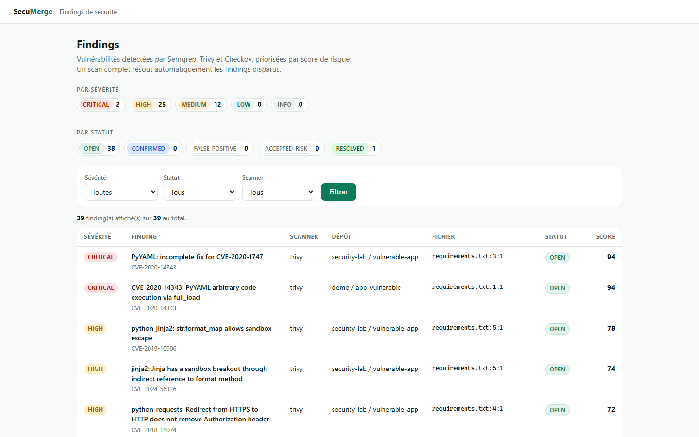
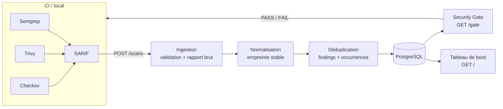

# SecuMerge

[](https://github.com/mohamedazizhachichi/secumerge/actions/workflows/security.yml)

Plateforme légère de gestion de findings de sécurité : elle ingère les résultats
de scanners externes (**Semgrep**, **Trivy**, **Checkov**), les normalise et les
déduplique, suit leur cycle de vie, calcule un score de risque explicable, les
affiche dans un tableau de bord, et **bloque la CI si un scanner attendu manque**.

Projet personnel de fin d'études — ING-5-SSIRF-J, TEK-UP University.

## Aperçu



## Le problème

Chaque scanner a son format, signale les mêmes problèmes à chaque exécution et
ne partage aucun cycle de vie. Sans agrégation : doublons, bruit, aucune
priorisation, et un pipeline qui ne sait pas si les contrôles ont réellement
tourné.

SecuMerge répond à ça avec une seule promesse :

> **Normalisation + agrégation + cycle de vie + visibilité + intégration DevSecOps.**

## Comment ça marche



Détails et décisions : [docs/architecture.md](docs/architecture.md).

## Stack

| Domaine | Choix |
|---|---|
| Backend | Python 3.13 · FastAPI · Pydantic |
| Base de données | PostgreSQL 17 · SQLAlchemy · Alembic |
| Interface | Jinja2 (page générée côté serveur, sans JavaScript) |
| Scanners | Semgrep (SAST) · Trivy (dépendances/conteneurs) · Checkov (IaC) |
| Développement | Docker · Docker Compose |
| CI/CD | GitHub Actions |
| Tests | pytest — 48 tests |

## Démarrage rapide

```powershell
git clone https://github.com/mohamedazizhachichi/secumerge.git
cd secumerge
Copy-Item .env.example .env
docker compose up --build
```

Dans un second terminal :

```powershell
docker compose exec api alembic upgrade head   # créer le schéma
docker compose exec api pytest                 # 48 tests
```

Puis ouvrir :

- http://localhost:8000/ — le tableau de bord des findings ;
- http://localhost:8000/docs — la documentation interactive de l'API ;
- http://localhost:8000/health — l'état de santé.

### Envoyer un rapport de scan

```powershell
curl.exe -X POST http://localhost:8000/scans `
  -F "file=@tests/data/semgrep-example.sarif" `
  -F "project=demo" -F "repository=app-vulnerable" `
  -F "scanner=semgrep" -F "commit_sha=abc123" -F "branch=main"
```

### Test Lab (démonstration complète)

```powershell
.\security-lab\run-lab.ps1
```

Lance les trois scanners sur des cibles volontairement vulnérables, envoie les
rapports à l'API, puis exige un **PASS** du Security Gate. Voir
[docs/demo.md](docs/demo.md).

## Intégration continue

Chaque push sur `main` et chaque pull request déclenche
[`.github/workflows/security.yml`](.github/workflows/security.yml) : démarrage
du stack, tests, scans Semgrep / Trivy / Checkov du dépôt, ingestion des
rapports, puis **Security Gate** — le job échoue si un scanner attendu manque ou
n'a pas produit de scan complet. Voir [docs/ci-cd.md](docs/ci-cd.md).

## Documentation

| Document | Contenu |
|---|---|
| [architecture.md](docs/architecture.md) | Composants, modèle de données, flux, décisions d'architecture |
| [setup.md](docs/setup.md) | Installation pas à pas et dépannage |
| [development.md](docs/development.md) | Organisation du code, conventions, ajouter un parseur ou une migration |
| [security.md](docs/security.md) | Posture sécurité et limites connues |
| [scanners.md](docs/scanners.md) | Semgrep, Trivy, Checkov : cibles, extraction, mapping des sévérités |
| [ci-cd.md](docs/ci-cd.md) | Le pipeline GitHub Actions en détail |
| [testing.md](docs/testing.md) | Stratégie et organisation des tests |
| [demo.md](docs/demo.md) | Scénario de démonstration complet |
| [spec-secumerge.md](docs/spec-secumerge.md) | Spécification complète du projet |
| [planning.md](docs/planning.md) | Cahier des charges et planning initial |

## Limites connues

- Pas d'authentification : l'API est ouverte (hors périmètre du MVP) ;
- le Security Gate vérifie la **présence** des scanners, pas encore la criticité
  des findings (échouer sur un nouveau `CRITICAL` est envisagé) ;
- un finding résolu qui réapparaît n'est pas rouvert automatiquement ;
- les images de scanners et certaines dépendances ne sont pas épinglées ;
- pas de quota de stockage par dépôt pour les rapports bruts.

Détail et suite prévue (durcissement) : [docs/security.md](docs/security.md).

## Auteur

**Mohamed Aziz Hachichi** — PFE ING-5-SSIRF-J, TEK-UP University.
