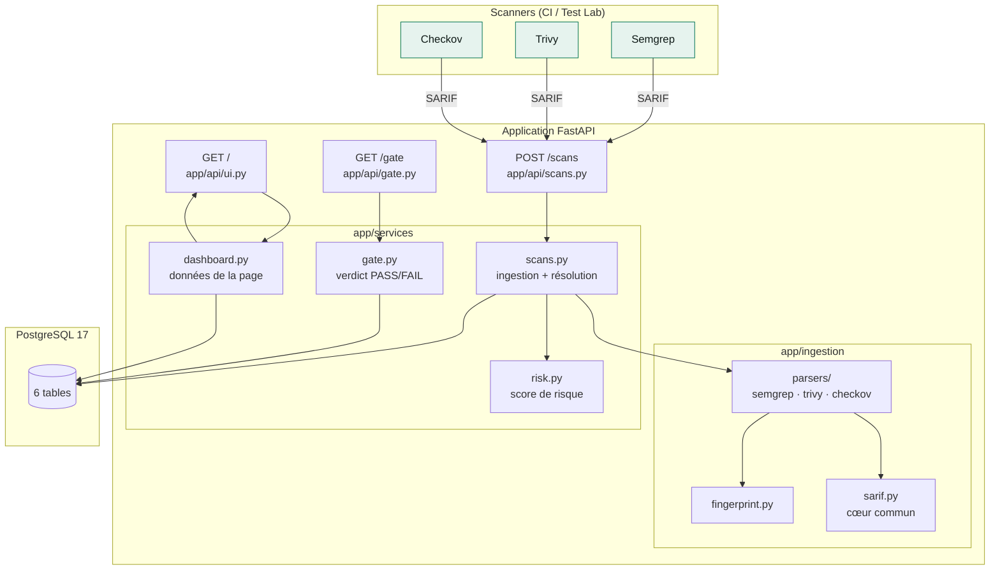
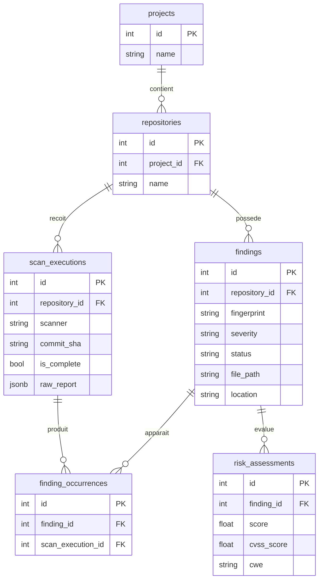
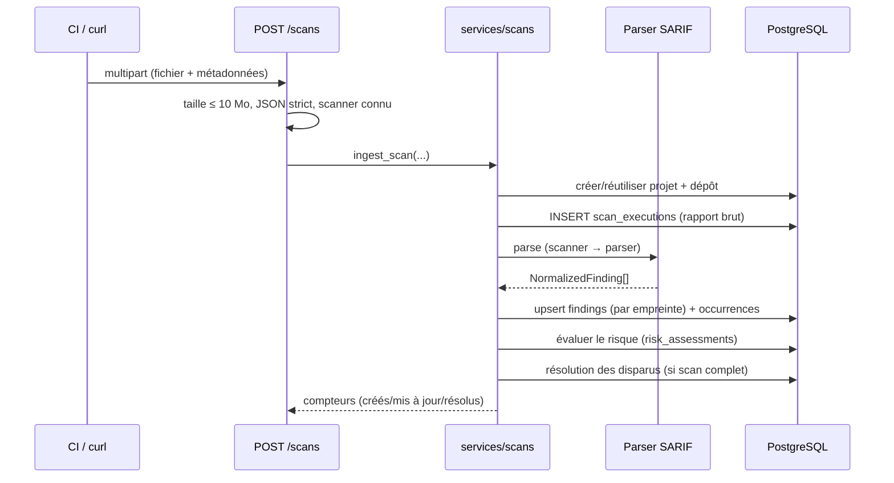

# Architecture

## Vue d'ensemble

SecuMerge est un **monolithe modulaire** : une seule application FastAPI, des
modules internes aux responsabilités claires, une base PostgreSQL.

## Composants

| Module | Responsabilité |
|---|---|
| `app/api/` | Routes HTTP : ingestion (`/scans`), gate (`/gate`), interface (`/`), santé (`/health`) |
| `app/ingestion/` | Parsing SARIF tolérant, normalisation, empreinte stable |
| `app/services/` | Logique métier : ingestion, scores de risque, gate, requêtes du dashboard |
| `app/models/` | Modèle de données SQLAlchemy (6 tables + énumérations) |
| `app/schemas/` | Contrats Pydantic de l'API |
| `app/templates/` | Page Jinja2 du tableau de bord |

## Modèle de données

- **`findings`** : un problème unique par dépôt, identifié par son empreinte
  (`uq_findings_repository_fingerprint`).
- **`finding_occurrences`** : « ce finding a été vu dans ce scan-là » — c'est la
  trace brute, le finding reste la vue agrégée.
- **`risk_assessments`** : une évaluation courante par finding (score +
  ingrédients), recalculée à chaque ingestion.
- **`scan_executions.raw_report`** (JSONB) : le rapport du scanner stocké tel
  quel, pour la traçabilité et les re-normalisations futures.

## Flux : ingérer un rapport

## Flux : résolution automatique

Un scan **complet** dont le rapport contient au moins un `run` SARIF est
considéré comme une source de vérité : les findings du **même dépôt et du même
scanner**, au statut `OPEN` ou `CONFIRMED`, absents du rapport passent à
`RESOLVED`.

Garde-fous : un scan partiel (`is_complete=false`) ne résout rien ; un rapport
sans structure SARIF (ex. `{}`) ne résout rien ; `FALSE_POSITIVE` et
`ACCEPTED_RISK` sont des décisions humaines jamais écrasées ; un finding
`RESOLVED` qui réapparaît n'est pas rouvert (limite connue).

## Flux : Security Gate

`GET /gate?project=…&repository=…&commit_sha=…` répond **PASS** si chacun des
trois scanners attendus a **au moins un scan complet** pour ce commit, sinon
**FAIL** avec la liste des manquants. Dépôt inconnu → FAIL (fail-closed).

## Décisions d'architecture

Chaque décision suit le format : problème, alternatives, choix, raison,
compromis.

### 1. Monolithe modulaire plutôt que microservices

- **Problème** : structurer le projet sans complexité inutile.
- **Alternatives** : microservices, bus d'événements.
- **Choix** : une seule application FastAPI, modules internes.
- **Raison** : le projet démontre l'ingénierie sécurité, pas les systèmes
  distribués.
- **Compromis** : pas de scalabilité indépendante par composant — inutile ici.

### 2. PostgreSQL + JSONB pour le rapport brut

- **Problème** : garder le rapport d'origine pour la traçabilité.
- **Alternatives** : fichiers sur disque, stockage objet, ne rien garder.
- **Choix** : colonne JSONB dans `scan_executions`.
- **Raison** : transactionnel avec le reste, interrogeable, suffisant à cette
  échelle.
- **Compromis** : la base grossit avec les rapports — quota à prévoir (limite
  connue).

### 3. Empreinte de déduplication déterministe

- **Problème** : reconnaître le même problème entre deux scans sans IA.
- **Alternatives** : fuzzy matching, titre normalisé, identifiant du scanner.
- **Choix** : `sha256(scanner | rule_id | fichier | ligne:colonne)`.
- **Raison** : stable, explicable, indépendant du texte (qui peut être
  reformulé).
- **Compromis** : un finding qui change de position est considéré comme
  nouveau — acceptable et documenté.

### 4. Résolution automatique prudente

- **Problème** : savoir qu'un problème a disparu, sans fausser le cycle de vie.
- **Alternatives** : tout résoudre sur chaque scan, ne jamais résoudre.
- **Choix** : résolution uniquement sur scan complet + SARIF exploitable, et
  uniquement `OPEN`/`CONFIRMED`.
- **Raison** : l'absence de preuve n'est pas une preuve ; les décisions
  humaines (`FALSE_POSITIVE`, `ACCEPTED_RISK`) sont protégées.
- **Compromis** : un rapport valide mais vide résout tout le scanner — c'est le
  comportement voulu d'un scan complet réussi.

### 5. Sévérité : niveau SARIF, affinée par le CVSS

- **Problème** : des échelles hétérogènes (error/warning/note, CVSS 0-10).
- **Alternatives** : ne garder que le niveau, ne garder que le CVSS.
- **Choix** : `security-severity` (CVSS) quand présent, sinon le niveau.
- **Raison** : le CVSS distingue `CRITICAL` de `HIGH` que le niveau écrase.
- **Compromis** : dépend de la qualité des métadonnées du scanner.

### 6. Score de risque simple et explicable

- **Problème** : prioriser sans boîte noire.
- **Alternatives** : score composite pondéré complexe, tri par sévérité seule.
- **Choix** : base par sévérité (90/70/50/30/10), moyenne avec `CVSS × 10`
  si fourni, facteur de confiance (×1 / ×0.9 / ×0.8), borné 0-100 ; CWE stocké
  comme information.
- **Raison** : chaque score se défend en entretien, les ingrédients sont en
  base.
- **Compromis** : moins « fin » qu'un scoring multi-critères — assumé.

### 7. Security Gate fail-closed

- **Problème** : empêcher la fusion d'un commit non réellement scanné.
- **Alternatives** : vérifier la simple présence d'un scan ; vérifier les
  findings.
- **Choix** : exiger un scan **complet** par scanner, FAIL sinon (dépôt inconnu
  compris).
- **Raison** : un scan partiel n'est pas une preuve ; mieux vaut bloquer que
  laisser passer.
- **Compromis** : un scanner en panne bloque le dépôt — c'est voulu, et visible
  dans la réponse (`missing`).

### 8. Interface Jinja2 sans JavaScript

- **Problème** : rendre les findings visibles simplement.
- **Alternatives** : React, HTMX, JavaScript maison.
- **Choix** : une page serveur, filtres en GET, CSS intégré.
- **Raison** : le projet démontre la sécurité, pas le frontend ; surface
  d'attaque minimale, rien à builder.
- **Compromis** : rechargements complets, pas d'interactions riches — suffisant
  pour consulter et filtrer.

### 9. Scanners conteneurisés, règles locales pour le lab

- **Problème** : exécuter trois scanners sans les installer, partout pareil.
- **Alternatives** : installations locales (pip/binaire), images maison.
- **Choix** : images officielles (`semgrep/semgrep`, `aquasec/trivy`,
  `bridgecrew/checkov`) ; règles Semgrep locales pour le Test Lab.
- **Raison** : reproductible Windows/Linux/CI ; le lab reste déterministe.
- **Compromis** : images non épinglées (limite connue), premier lancement
  gourmand en téléchargements.
