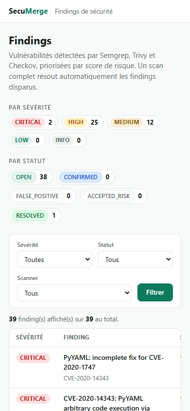

# Démonstration

Scénario complet (~10 minutes) pour montrer le projet : du scan au gate.

## 1. Démarrer la plateforme

```powershell
docker compose up -d
docker compose exec api alembic upgrade head
```

Ouvrir http://localhost:8000/ — le tableau de bord :


Sur mobile, la même page s'adapte :



## 2. Lancer le Test Lab (pipeline complet)

```powershell
.\security-lab\run-lab.ps1
```

Le script lance les trois scanners sur les cibles volontairement vulnérables,
envoie les rapports et vérifie le gate. Sortie attendue :

```text
Verification de l'API http://localhost:8000 ...
API OK - commit de test : lab-20261010105900
[1/4] Semgrep ... [2/4] Trivy ... [3/4] Checkov ... [4/4] Envoi ...

Scanner ScanId Nouveaux MisAJour Resolus
------- ------ -------- -------- -------
semgrep  ...         5        0       0
trivy    ...        12        0       0
checkov  ...        18        0       0

Pipeline complet OK : gate PASS pour lab-...
```

**À dire** : 35 findings réels (règles locales + CVE connues + IaC), tous
normalisés avec une empreinte stable — relancer le script produit
« MisAJour », pas de doublons.

## 3. Explorer dans le dashboard

- Trier/repérer le CVE PyYAML : `CRITICAL`, score **94** (CVSS 9.8 moyenné) ;
- montrer les badges CWE (`CWE-95`, `CWE-78`) ;
- filtrer par sévérité `CRITICAL`, puis par scanner `checkov` ;
- le finding `subprocess` est `RESOLVED` : il a « disparu » d'un scan complet
  ultérieur (démo de l'Étape 5).

## 4. Le Security Gate

```powershell
# PASS : les trois scanners ont un scan complet pour ce commit
curl.exe -s "http://localhost:8000/gate?project=security-lab&repository=vulnerable-app&commit_sha=<commit-demo>"

# FAIL : un commit où seul semgrep a tourné
curl.exe -s "http://localhost:8000/gate?project=demo&repository=app-vulnerable&commit_sha=def456"
```

Montrer la réponse : `status`, détail par scanner, `missing`. **À dire** : le
gate est *fail-closed* — dépôt inconnu = FAIL, la preuve manquante n'est jamais
un PASS.

## 5. La CI sur GitHub

Ouvrir l'onglet **Actions** du dépôt : le workflow « security » est vert, et
c'est le même parcours — tests, trois scanners, ingestion, gate — qui tourne à
chaque push et sur chaque pull request.

## Points à creuser en questions

| Sujet | Où c'est dans le code |
|---|---|
| Empreinte / déduplication | `app/ingestion/fingerprint.py` |
| Normalisation SARIF | `app/ingestion/sarif.py`, `parsers/` |
| Cycle de vie + résolution | `app/services/scans.py` (`_resolve_missing_findings`) |
| Score de risque | `app/services/risk.py` |
| Gate fail-closed | `app/services/gate.py` |
| Choix d'architecture et compromis | `docs/architecture.md` |
